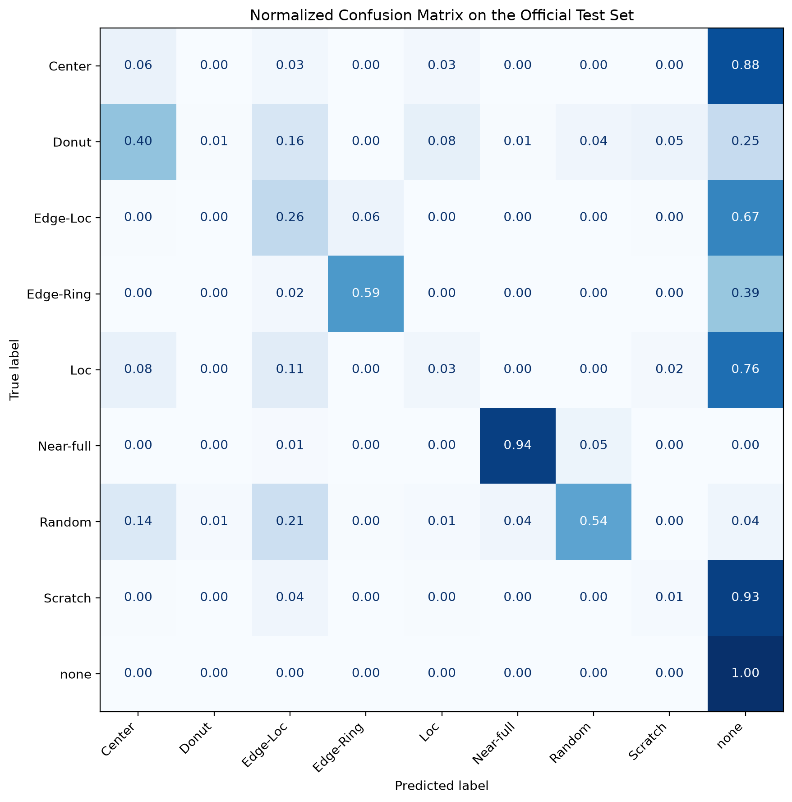

# Wafer-Map Defect Pattern Classification with PyTorch

A small CNN study on WM-811K wafer maps, with lot-disjoint evaluation and class-level error analysis. The project investigates the difference between high overall accuracy and reliable minority-defect recognition. These are die-status maps, **not microscopy images**.

## Main CNN results

| Item | Saved result |
|---|---:|
| Labelled maps available | 172,950 |
| Classes | 8 defect patterns + `none` |
| Input | 1 × 64 × 64 |
| Trainable parameters | 24,105 |
| Official test maps | 118,595 |
| Test accuracy | 94.38% |
| Test macro-F1 | **0.4160** |
| Test balanced accuracy | **0.3821** |
| Best validation macro-F1 | 0.7041 |

The official test set is 93.34% `none`. High accuracy therefore hides weak recognition of several defect types. The validation-to-test gap is substantial; the model is **not deployment-ready**.

Source: [saved metrics](reports/final_metrics.json), [per-class results](reports/test_classification_report.csv).



## Method

- Preserve the official test split and form training/validation sets with lot grouping; check that sample IDs and lots do not overlap.
- Center-pad each map to a square, resize to 64 × 64 using nearest-neighbor interpolation, and divide by 2.
- Train a three-block CNN with weighted cross-entropy, Adam and validation macro-F1-based early stopping.
- Inspect class-wise recall, confusion patterns, confidence and example Grad-CAM maps.

A retrospective confidence threshold of 0.70 flags 22.11% of test maps and captures 61.80% of prediction errors. This threshold is illustrative, not independently validated or evidence of calibrated uncertainty. Grad-CAM does not establish physical root causes.

## Start here

1. [Data audit](notebooks/01_data_audit.ipynb)
2. [Preprocessing and split](notebooks/02_preprocessing_and_split.ipynb)
3. [CNN training](notebooks/03_cnn_training.ipynb)
4. [Evaluation and Grad-CAM](notebooks/04_evaluation_and_gradcam.ipynb)
5. [Classical dimensionality baseline](experiments/dimensionality_baseline/README.md)

## Run the CNN study

```bash
python3 -m venv .venv
source .venv/bin/activate
python -m pip install -r requirements.txt
python -m jupyterlab
```

Start with Python 3.12. Obtain WM-811K from [the source data card](https://www.kaggle.com/datasets/qingyi/wm811k-wafer-map). Place a ZIP containing exactly one `LSWMD.pkl` at `data/raw/WM811K_source.zip`. Load only trusted pickle files; they can execute code. The raw archive is omitted from this repository.

Run notebooks 01–04 in order, using the project root or `notebooks/` as the working directory and restarting the kernel between notebooks. Notebook 02 generates split manifests. Notebook 03 generates the CNN checkpoint required by Notebook 04; weights are excluded, so evaluation cannot run from raw data alone without training. Choose a supported CPU/GPU device for your environment.

Saved outputs can be reviewed without installing PyTorch. `models/` contains generated evaluation artifacts; `reports/` contains browsing copies. Refresh report copies after rerunning experiments. Requirements are compatibility ranges rather than a locked environment.

## Additional classical baseline

The portable [PCA / PCA+LDA study](experiments/dimensionality_baseline/README.md) includes a small derived dataset and cached original CNN predictions. Validation selected PCA16 + 3NN. On the common **1,616-map, class-capped test subset**, its macro-F1 was **0.4347**, compared with **0.3481** for the original CNN on those same maps. A paired lot-bootstrap interval for the difference was [0.0596, 0.1122].

These are different class proportions from the full test set, different training budgets, and a retrospective comparison. The baseline performs poorly on normal maps and cannot simply replace the CNN. No comparable CNN timing was measured; no speedup, hardware deployment or energy claim is made.

## Scope

No physical defect root-cause diagnosis, production deployment, yield improvement, quantization, FPGA/NPU implementation or EDA experiment is claimed. See [data attribution](DATA_SOURCES.md), [research scope](RESEARCH_NOTES.md), and [publication checks](PUBLICATION_CHECKS.md). Personal learning project developed with AI assistance. No additional code license has been selected.
